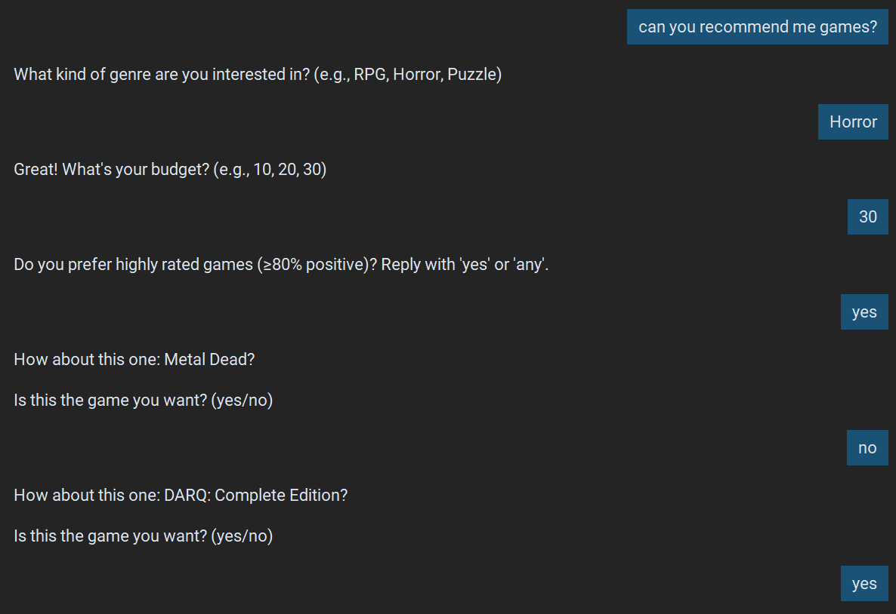
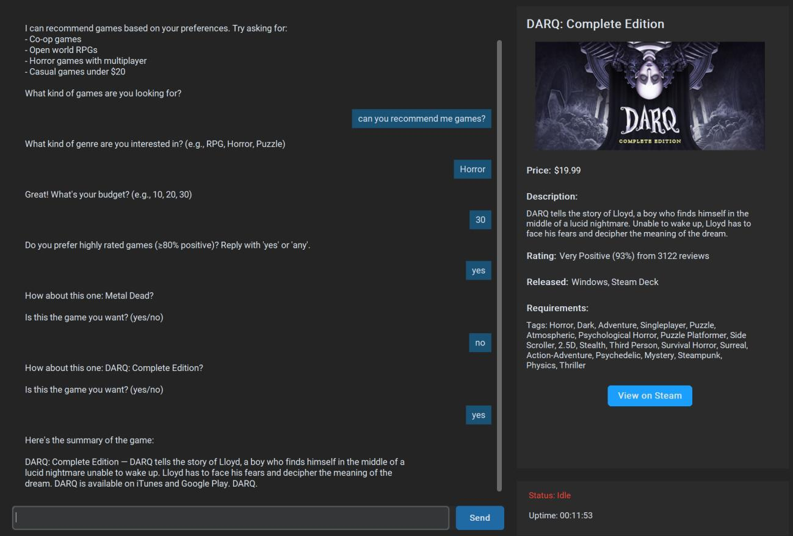

# GamerBuddy: An NLP-Powered Game Recommendation Chatbot

A desktop chatbot that helps users discover Steam games through natural conversation. The system combines **BERT intent classification**, **rule-based game filtering**, and **generative language models** to recommend games and produce conversational responses.

Built with Python, PyTorch, Hugging Face Transformers, and CustomTkinter.

## Features

- **Intent recognition:** distinguishes game recommendation requests from casual conversation using a fine-tuned BERT classifier.
- **Personalized recommendations:** collects genre, budget, and review preferences through a step-by-step conversation.
- **Alternative suggestions:** lets users accept a recommended game or browse the next match.
- **Generated descriptions:** uses T5 and BART to paraphrase, correct, and rewrite game descriptions.
- **Casual conversation:** uses Phi-2 with a gamer-assistant persona and recent conversation context.
- **Multiple chat views:** create and switch between conversation histories during the application session.
- **Game details:** displays cover art, prices, ratings, supported platforms, tags, and a Steam store link.
- **Interactive desktop UI:** dark theme, typing animation, scrolling messages, active/idle status, and uptime display.
- **NLP preprocessing:** generates tokens, word frequencies, n-grams, lemmas, POS tags, and vocabulary files.

## Libraries and Tools

| Library / Tool | Purpose |
| --- | --- |
| Python | Application and data-processing logic |
| PyTorch | Model training and inference |
| Hugging Face Transformers | BERT, Phi-2, T5, and BART models |
| Accelerate | Automatic model device placement |
| Pandas | Game metadata preparation and dataset handling |
| scikit-learn | Label encoding, data splitting, and accuracy evaluation |
| NLTK | Tokenization, lemmatization, POS tagging, and corpus analysis |
| CustomTkinter | Desktop chat interface |
| Pillow | Game cover image processing |
| Requests | Downloading Steam cover images |
| tqdm | Training progress display |
| SentencePiece / Safetensors | Tokenizer and model-file support |

### Models

| Component | Model |
| --- | --- |
| Intent classifier | [`bert-base-uncased`](https://huggingface.co/google-bert/bert-base-uncased), fine-tuned for recommendation/chitchat classification |
| Chat generation | [`microsoft/phi-2`](https://huggingface.co/microsoft/phi-2) |
| Description paraphrasing | [`Vamsi/T5_Paraphrase_Paws`](https://huggingface.co/Vamsi/T5_Paraphrase_Paws) |
| Grammar correction | [`vennify/t5-base-grammar-correction`](https://huggingface.co/vennify/t5-base-grammar-correction) |
| Description rewriting | [`facebook/bart-large-cnn`](https://huggingface.co/facebook/bart-large-cnn) |

## System Workflow

```text
User message
    |
BERT intent classifier
    |
    +-- Recommendation request
    |       |
    |   Collect genre, budget, and rating preferences
    |       |
    |   Filter the local game dataset
    |       |
    |   Present matching games -> accept or show next
    |       |
    |   T5 / BART description processing
    |       |
    |   Display summary and game details
    |
    +-- Casual conversation
            |
        Phi-2 response generation
            |
        Display chat reply
```

Recommendations use locally stored Steam metadata. Game cover images are loaded from Steam's CDN.

## Dataset

### Game Records

The cleaned game dataset contains **34,669 records**, with fields including:

- Steam app ID and title
- Description and genre tags
- Original price, final price, and discount
- Review category, positive-review percentage, and review count
- Windows, macOS, Linux, and Steam Deck support flags

`preprocessing.py` joins `games.csv` and `games_metadata.json`, filters incomplete records and non-ASCII descriptions/tags, and saves the resulting catalogue to `datasets/data.json`.

### Intent Classification Data

| Category | Examples |
| --- | ---: |
| Generated recommendation prompts | 3,000 |
| Manually supplied recommendation prompts | 96 |
| Casual conversation examples | 3,150 |
| **Total** | **6,246** |

Intent examples are stored in `datasets/intent/intent_dataset.jsonl` with two labels: `recommendation` and `chitchat`.

## Project Structure

```text
Multipurpose_Game_Recommendation_Chatbot/
|-- main.py                       # Desktop UI, chat views, and game display
|-- game.py                       # Recommendation survey and text generation
|-- intent.py                     # BERT training/loading and Phi-2 chat
|-- preprocessing.py              # Data cleaning and NLP preprocessing
|-- datasets/
|   |-- data.json                 # Cleaned game catalogue
|   |-- games.csv                 # Game metadata table
|   |-- games_metadata.json        # Descriptions and tags
|   |-- recommendations.csv
|   |-- intent/
|   |   |-- chitchat_3150.json
|   |   |-- recommendation.json
|   |   |-- intent_dataset.json
|   |   `-- intent_dataset.jsonl
|   `-- ...                       # Generated NLP analysis files
|-- intent_model/
|   |-- config.json
|   |-- label_encoder.json
|   |-- model.safetensors
|   |-- pytorch_model.bin
|   `-- ...                       # Tokenizer files
|-- docs/
|   `-- screenshots/
`-- README.md
```

## Installation

### 1. Create a Python Environment

From the project root in PowerShell:

```powershell
py -3.11 -m venv .venv
```

### 2. Install Dependencies

```powershell
.\.venv\Scripts\python.exe -m pip install torch "transformers>=4.37,<5" accelerate safetensors sentencepiece protobuf pandas scikit-learn tqdm customtkinter Pillow requests nltk
```

For a specific CUDA installation, use the command from the [PyTorch installation guide](https://pytorch.org/get-started/locally/) with the environment's Python executable. This package list reflects the source imports; it is not a version-locked environment.

### 3. Prepare the Data and Classifier

Keep the `datasets/` and `intent_model/` directories in the project root. The application reads game data from `datasets/data.json` and loads the saved BERT classifier from `intent_model/`.

The other language models download through Hugging Face on first use. Model initialization takes place before the desktop window opens.

### 4. Start the Application

```powershell
.\.venv\Scripts\python.exe main.py
```

Run the command from the project root so the data paths resolve correctly. When `intent_model/` is absent, `intent.py` automatically starts BERT fine-tuning during startup.

## Usage

1. Start the application and enter a recommendation request.
2. Provide a genre, budget, and rating preference when prompted.
3. Review the suggested game and its details.
4. Reply `no` or `next` for another match, or `yes` for a generated summary.
5. Select **View on Steam** to open the game's store page.
6. Use **New Chat** to create another conversation view.

```text
You: Can you recommend a game?
Bot: What kind of genre are you interested in?
You: RPG
Bot: What's your budget?
You: 20
Bot: Do you prefer highly rated games? Reply with 'yes' or 'any'.
You: any
Bot: How about this one: <matching game>? Is this the game you want?
You: yes
Bot: Here's the summary of the game: <generated description>
```

## Training

### Data Preprocessing

```powershell
.\.venv\Scripts\python.exe preprocessing.py
```

This rebuilds the cleaned game catalogue and NLP analysis files from the source datasets. It also downloads the NLTK resources used by the script.

### Intent Classifier

```powershell
.\.venv\Scripts\python.exe intent.py
```

The script loads an existing `intent_model/` directory or fine-tunes BERT when that directory is absent. Back up the saved classifier before using a separate working copy for retraining.

| Training Setting | Value |
| --- | --- |
| Base model | BERT-base-uncased |
| Training / validation split | 80% / 20% |
| Optimizer | AdamW |
| Learning rate | 2e-5 |
| Batch size | 16 |
| Epochs | 3 |
| Maximum sequence length | 64 tokens |

## Results

The project report records the following **BERT intent-classification results** in Section 4.1 and the training-log appendix:

| Epoch | Training Accuracy | Validation Accuracy | Validation Loss |
| --- | ---: | ---: | ---: |
| 1 | 98.42% | 99.60% | 0.0134 |
| 2 | 99.96% | 99.76% | 0.0074 |
| 3 | **99.90%** | **99.84%** | **0.0064** |

The final reported validation accuracy is **99.84%** for distinguishing recommendation requests from casual conversation on the project's validation split.

### Recommendation Conversation



### Game Recommendation Display


